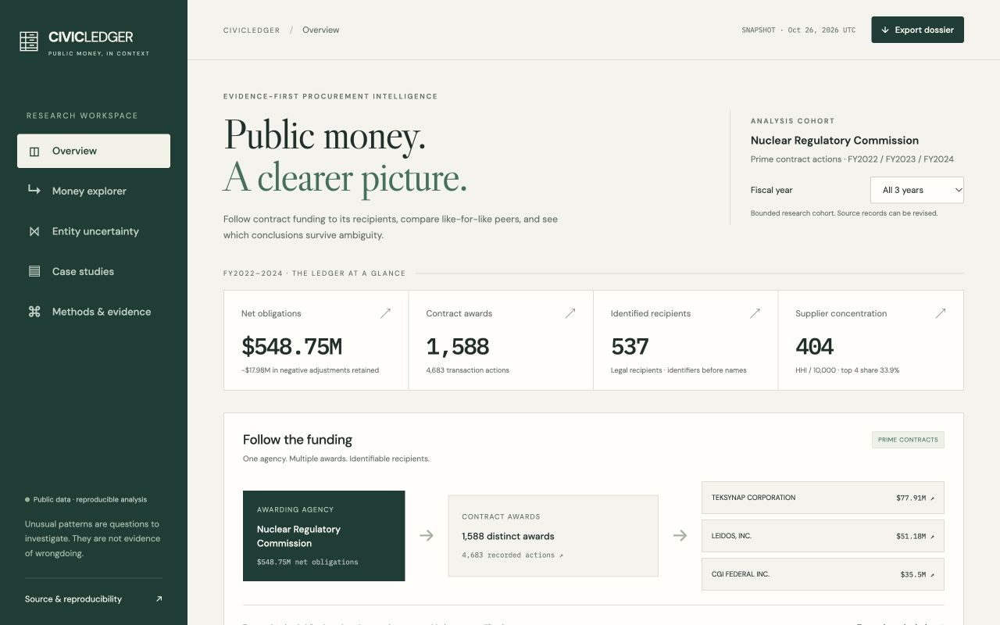

# CIVICLEDGER

**Public money, in context.** An evidence-first public procurement explorer with a reproducible DuckDB/dbt warehouse and a decision-sensitive entity review study.

[Open the explorer](https://civicledger.nazeeh1.chatgpt.site) · [Analytical findings](docs/EDA.md) · [Three case studies](docs/CASE_STUDIES.md) · [Linkage research](docs/LINKAGE.md) · [SQL cookbook](docs/SQL_COOKBOOK.md)

The initial release covers **4,683 Nuclear Regulatory Commission contract actions, 1,588 awards and 537 legal recipient identifiers across FY2022–FY2024**. Net obligations are **$548,751,367.35**, including **−$17,977,335.52** in negative adjustments. These are commitments, not cash paid. The three annual net totals reconcile to USAspending's transaction-level aggregate to the cent using identical agency, award-type and action-date filters.



## Explore a conclusion, then inspect its evidence

Follow the agency to an award and its recipient. Inspect signed modifications, source links and cumulative in-window commitments. Compare industry peers, read every denominator and open the SQL behind the measures. Export a case dossier or a short decision memo. No account or API key is needed for the public explorer.

Entity ambiguity is handled explicitly. All released transactions have UEIs, so the live data require no speculative name merges. Same-name records with different identifiers stay separate. A separate masked-identifier experiment evaluates exact matching, normalized matching, a Splink/Fellegi–Sunter baseline, calibration and review allocation. Synthetic spelling perturbations are labeled separately from observed-data results.

The original workflow prioritizes identity reviews by the expected change in a downstream concentration or ranking decision. It samples valid whole-cluster partitions and conditions those scenarios on review answers. It does not independently flip pairwise matches into inconsistent clusters. Experiments compare random, uncertainty-only and decision-sensitive review under equal budgets. See the research report for results and limits, including the small number of natural positive test pairs.

## Rebuild the released snapshot

Requirements: Python 3.12 or 3.13, Node.js 20+, and the free [uv](https://docs.astral.sh/uv/) package manager. No billed APIs or credentials.

```sh
git clone https://github.com/nazeeh111/civicledger.git
cd civicledger
uv sync --frozen --extra test
uv run python -m civicledger.reproduce --test
uv run python -m http.server 8000 --directory app/dist
```

Open `http://localhost:8000`. The default command uses the published, minimized CSV and its SHA-256 manifest, rebuilds SQL tables and dbt models, reruns EDA and linkage experiments, regenerates explorer projections, and runs tests. It refuses a CSV whose hash differs from its manifest. No network data retrieval is needed for this path after installing dependencies.

To retrieve a **new** source snapshot:

```sh
uv run python -m civicledger.reproduce --refresh --test
```

Historical records can be revised by the source, so a fresh retrieval can produce different totals. Each refresh retains a new raw directory, request body, retrieval timestamp, original ZIP/CSV hashes and source revision fields. The public CSV removes unnecessary addresses, telephone/fax fields, officer names/pay and whole descriptions containing contact details. Original full-field raw archives remain local and are excluded from Git and the public release. Their hashes and acquisition code are included. The source is public USAspending data; no personal credential is required.

For a faster warehouse/report iteration, `--skip-linkage` retains the existing linkage evidence. Do not use that option when changing linkage inputs for a release. A full release uses the default complete rebuild.

## Warehouse and analysis

| Layer | Grain and purpose |
|---|---|
| `data/raw/<snapshot>/` | Local-only original response/archive receipts; never silently rewritten |
| `data/processed/transactions.csv` | One minimized source transaction in the retrieved snapshot |
| `fact_transactions` | Typed incremental obligations, dates, identifiers, competition, revisions and lineage |
| `dim_recipient_history` | Observed identifier/name/parent/location attribute bundles |
| `mart_awards` | Aggregated in-window flows plus a separately selected latest reported award stock |
| dbt analytical models | Recipient-year cohorts, one observation per award-year, peer rates and revision lags |
| `data/reports/` | Census EDA, award-cluster resampling and three source-traceable cases |
| `data/linkage/` | Identifier-masked features/labels, benchmark predictions, valid-partition experiments |
| `app/dist/` | Public static explorer and its exact projected evidence |

The SQL uses window functions, conditional aggregates, joins across grains, observed attribute histories, cumulative obligations, peer concentration and within-window recipient entry/exit. See [SQL_COOKBOOK.md](docs/SQL_COOKBOOK.md) and [DATA_DICTIONARY.md](docs/DATA_DICTIONARY.md). The query profiles report actual local timings and plans on this bounded cohort. They do not establish large-scale performance.

HHI (Herfindahl–Hirschman index) is 10,000 times the sum of squared shares. This release uses nonnegative recipient-year **net balances** for concentration weights, while retaining every signed action in spending totals. Competition exposure and September shares use **gross positive action obligations**. These denominators answer different questions and are labeled in the explorer.

The independent EDA also compares reported-parent conventions and resamples whole awards to examine year-end composition sensitivity. The resampling ranges are not confidence intervals for the observed census and do not identify causal effects.

## What the data cannot establish

USAspending transactions are not OCDS tender/bid data. This release cannot calculate bid-price gaps, disqualified bids, late submissions or tender-window indicators. An offer count is only a reported field, not a full bidder register. [INDICATORS.md](docs/INDICATORS.md) documents the prerequisite audit against Cardinal and Open Contracting Partnership methods.

The source can revise prior transactions. Action-date histories in a current snapshot are not as-of historical database snapshots. First/last observation in FY2022–24 is not supplier formation/exit or full contract history. Reported parent attributes are not verified beneficial ownership. High spending, low competition and unusual timing can have lawful ordinary explanations.

There are no adjudicated misconduct labels. CIVICLEDGER never reports fraud-detection accuracy, alleges corruption, or treats anomaly scores as proof of wrongdoing.

## Validation and release

See [RELEASE.md](docs/RELEASE.md) for the checked version, exact commands, limitations and release links. CI repeats the offline rebuild and checks from the minimized public snapshot. Raw-provenance checks run when the intentionally excluded originals are locally available and otherwise report an explicit skip.

## Foundations and license

[USAspending API and source contracts](https://github.com/fedspendingtransparency/usaspending-api), [Splink](https://github.com/moj-analytical-services/splink), [Cardinal](https://github.com/open-contracting/cardinal-rs), [OCP methodology](https://www.open-contracting.org/resources/red-flags-in-public-procurement-a-guide-to-using-data-to-detect-and-mitigate-risks/), and [Evidence](https://github.com/evidence-dev/evidence) informed this project. Exact inspected source revisions are recorded in `docs/source-revisions.json`. DuckDB and dbt implement the warehouse; Splink executes the probabilistic baseline. The explorer uses a small static renderer over SQL outputs, inspired by Evidence's SQL-reporting approach. Cardinal is used for prerequisite inspection, not executed against an invented OCDS conversion.

Code: [MIT](LICENSE). USAspending source implementation is CC0; source data are attributed to the U.S. Department of the Treasury/USAspending. Upstream software and documentation retain their respective licenses. No upstream code or OCP narrative is represented as an original CIVICLEDGER method.
