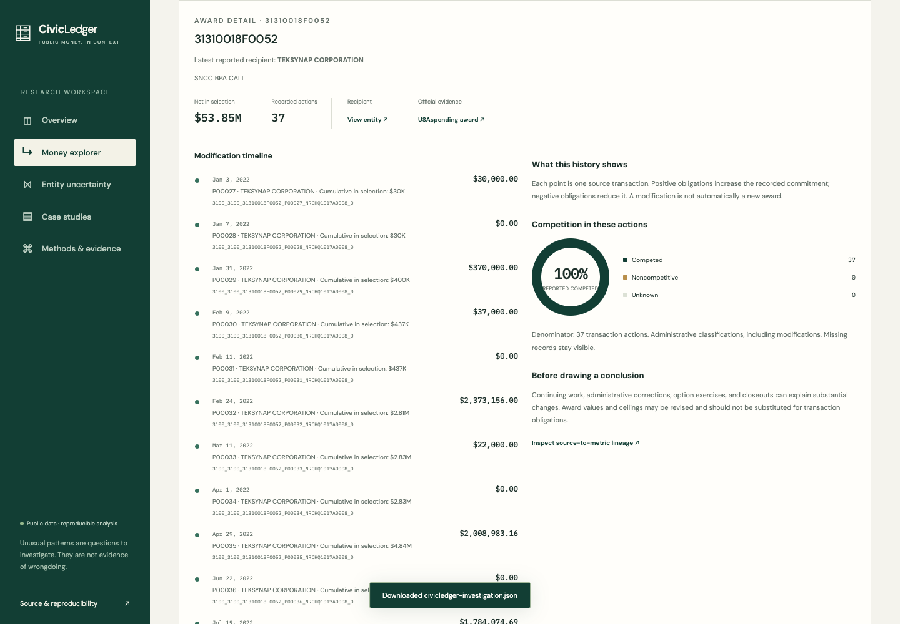

# A reduction belongs in the ledger

This new bounded journey uses the already retained, minimized U.S. Department of the Treasury / USAspending public snapshot `20261026T015420Z`, covering NRC prime contract actions in FY2022–FY2024. No external retrieval, private full-field archive, account, linkage experiment or new study was used. The source implementation's CC0 license is separate from this data attribution; CivicLedger's own code is MIT and embedded figure fonts retain SIL Open Font License notices alongside them.

## Follow the selected source action

The recorded case selects the most negative individual obligation among 4,683 cohort actions: modification **P00050**, dated **25 May 2023**, of award **31310018F0052**, recipient **TEKSYNAP CORPORATION**. Its signed amount is **−$1,335,317.53**. The [official award page](https://www.usaspending.gov/award/CONT_AWD_31310018F0052_3100_NRCHQ1017A0008_3100/) may now contain later source revisions and lifetime totals. It is not this immutable snapshot.

The [37 selected award actions](award-actions.csv) are ordered by action date and transaction ID. Native DuckDB DECIMAL results and independent raw-CSV Decimal arithmetic agree on every action and cumulative value:

- Positive commitments: **$56,164,185.63**.
- Negative adjustments: **−$2,311,317.53**.
- In-window net: **$53,852,868.10**.

[Exact SQL](query.sql), [source identities and reconciliation](ledger-check.json), [saved investigation](investigation.json), [actual native case dossier](case-dossier.json) and [decision memo](decision-memo.txt) are retained. The fixed case dossier deliberately carries the complete cohort to preserve its case denominator; it is not a 37-row award-only export. The saved investigation separately contains exactly the selected award's 37 IDs and metrics.

The figure includes all 37 actions. Calendar-date x position is linear in days; cumulative y position is dollars with a zero baseline and a labeled millions scale. The step holds each cumulative balance between observed actions. Duplicate dates and all signed values remain; no smoothing, resampling or dropped zero/negative action. The initial zero is the in-cohort balance, not the award's lifetime starting balance. [Desktop SVG](ledger.svg), [phone SVG](ledger-mobile.svg), [generator](figure.py) and [figure hashes](figure-manifest.json) are included. The highlighted point identifies the selected adjustment.

Obligations are commitments, not cash paid. A reduction can reflect closeout, scope/funding correction or another ordinary administrative adjustment. Its amount alone establishes neither misconduct nor whether the activity was appropriate. UEI identifies a reported legal recipient, not verified ultimate ownership. This is a source-traceable selected observation, not a new public-impact or causal finding.

## Reopen and recompute the complete artifact

After extracting the worked archive, use Python 3.12 or 3.13 with the declared `duckdb==2.0.0` installed in your isolated environment:

```sh
python3 -I -B reopen.py
python3 -I -B reopen.py --serve --port 8185
```

The reader verifies every MANIFEST.json member, opens the actual pinned generation through CivicLedger's unmodified verifier, runs the SQL against the included warehouse, independently recomputes the 37 rows from its minimized public CSV and checks saved-investigation IDs/net. `--serve` exposes only the original generation's declared hash-verified public files on loopback. Open the printed URL, choose **Open investigation**, and select investigation.json. Stop with Ctrl+C. A fresh extraction/recompute and actual browser reopening were tested. The ZIP download is linked from the root repository README; this guide has no relative link to a missing second copy of its own archive.

The archive includes the exact generation identity, every declared generation artifact, public minimized input, SQL, matching retained analysis/linkage/dbt records, current workspace source, public app assets/fonts and notices. Its unsigned hashes detect changes but do not authenticate the publisher. Private original raw archives are not present. Dataset/source attribution remains with the records. The original full-field source is intentionally unavailable here.

This generation was built with the supported **warehouse-only** route, reusing matching retained dbt/linkage/report evidence. It does not rerun dbt or the entity-linkage study. Actual DuckDB 2.0.0, Python 3.13.11 and locked pytz 2026.5 were used. A first minimal-environment attempt lacked pytz; it failed without publishing a partial generation, then succeeded after installing that already locked dependency. Full runtime dependencies and complete release commands remain in the root README.

## Actual explorer route and preservation

The actual UI opened the deobligation case, exported its dossier/memo, searched the award, selected its full in-window actions, entered an explicitly bounded review note, and saved investigation.json. Fresh browser reopening in the same pinned generation restored the selection, notes, IDs and metrics exactly. Modified metrics, a different generation and malformed JSON were refused while preserving current state. Empty file selection also retained it. Empty search showed no matching awards and kept notes. Escape closed the evidence dialog. Actual desktop/375-pixel views had no page overflow.

<picture>
  <source media="(max-width: 600px)" srcset="explorer-mobile.png">
  
</picture>

No new UI/DX defect was demonstrated, so source, SQL, expert controls, machine interfaces and held code remain unchanged. Native warehouse/report/generation tests passed: 24 tests, with the intentionally undistributed original-source archive test skipped. The historical study and published totals remain separately attributed. No full release rebuild, data refresh, paid provider, training, hardware or production service was used.
